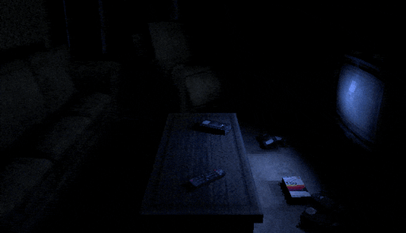

# 003-light Sample

> [!NOTE]
> This sample demonstrates the clustered lighting system + `ShadowPlugin`, using Virtual Shadow Maps (VSM).
> The house uses `STATIC` caster. The fans, security cameras and the basement monster use `DYNAMIC` casters.

