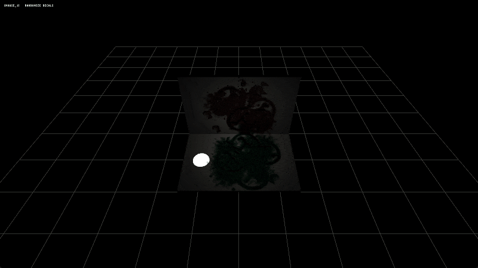

# 006-decals Sample

> [!NOTE]
> This sample demonstrates the usage of the clustered decal system. Currently, there is no support for decal masking, which means decals can render on top of any mesh.

