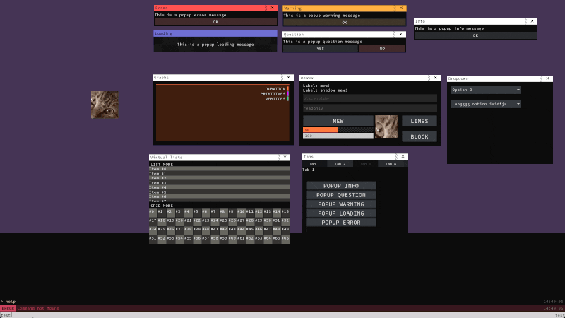

# 008-ui Sample

> [!NOTE]
> This sample showcases the usage of the UI module to create different components like frames, buttons, and inputs. It also demonstrates how to register custom commands using the console and how to utilize the popup system.

